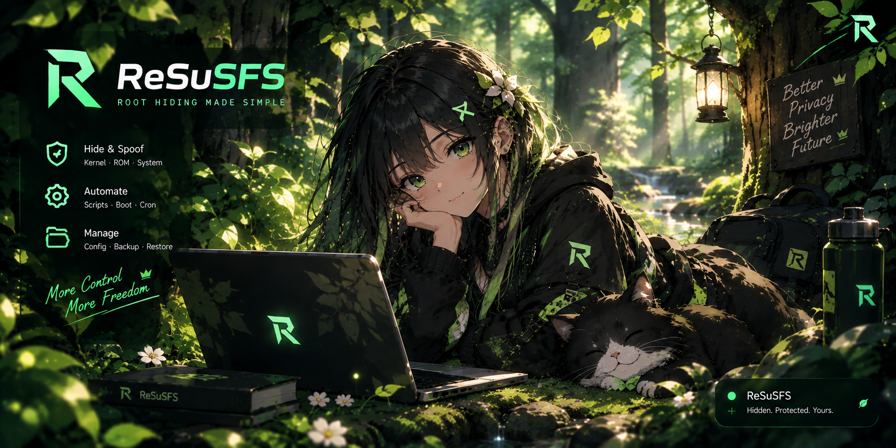

# ReSuSFS (patched KMI untuk kernel custom)

> **Kredit penuh karya asli: [ahmed-alnassif/ReSuSFS](https://github.com/ahmed-alnassif/ReSuSFS).**
> Repo ini BUKAN karya asli OmmniDevv. Repo ini adalah salinan ReSuSFS v26.10.23
> dengan SATU perbaikan saja (patch deteksi KMI di `utils.sh`), dibuat oleh
> **OmmniDevv (Abdul Malik Rizky Nur Rahmat)** agar modul ini jalan di kernel
> custom yang localversion-nya tidak standar. Lisensi tetap GPL-3.0, lihat `LICENSE`.
> Author di `module.prop`: ahmed-alnassif, OmmniDevv.

<p align="center">
  
  
</p>

## Bahasa Indonesia

### Apa yang diubah

Satu fungsi saja: `get_susfs_guard_lkm()` di `utils.sh`.

Pola sed asli:

```
s/^([0-9]+\.[0-9]+)\.[0-9]+-(android[0-9]+)-.*/\2-\1/
```

Pola itu hanya cocok untuk uname GKI standar, misalnya
`5.10.209-android12-9-g...`. Kalau kernel custom menyisipkan nama di tengah,
misalnya `5.10.269-KagamiChihiro-MillenniumTeam-android12-9+`, polanya gagal,
KMI tidak terdeteksi, dan ReSuSFS bilang tidak ada LKM yang cocok, padahal
KMI dasarnya adalah `android12-5.10` yang didukung.

Pola yang dipatch:

```
s/^([0-9]+\.[0-9]+)\.[0-9]+.*-(android[0-9]+)-.*/\2-\1/
```

Pola baru mengizinkan teks apa pun di antara versi patch dan tag android,
sehingga `5.10.269-KagamiChihiro-MillenniumTeam-android12-9+` terdeteksi
sebagai `android12-5.10`, dan tetap benar untuk uname GKI standar.

Semua file lain sama persis dengan upstream v26.10.23, kecuali
`module.prop` (author ditambah OmmniDevv, versionCode 22 menjadi 23,
updateJson diarahkan ke repo ini) dan catatan patch di `PATCH-NOTE.txt`.

### Perangkat yang sudah terverifikasi

- Infinix Note 30, boot.img InfinityRoot (@shitfinix69)
- Kernel: Linux 5.10.269-KagamiChihiro-MillenniumTeam-android12-9+
- KernelSU: mode LKM, kernelsu.ko dibundel di ramdisk, manager
  com.kowx712.supermanager
- Hasil: flash modul ini mengunduh `susfs_guard_lkm-android12-5.10.ko`
  (inforcqb v2.3.0-r18.4) dan `susfs_insmod` dengan sukses, dan setelah
  reboot `ReSuSFS --status` mendeteksi susfs aktif. Diverifikasi
  2026-10-28.

Catatan vermagic: LKM android12-5.10 vermagic-nya `5.10.252-dirty`,
berbeda dengan kernel 5.10.269 custom, tapi `susfs_insmod` memang
menambal vermagic di tempat sebelum memuat, dan kernel ini punya
`CONFIG_MODVERSIONS` dan `CONFIG_KALLSYMS_ALL` yang dibutuhkan loader itu.

### Cara pakai

1. Unduh zip dari halaman Releases repo ini, dari bagian Assets
   (bukan link raw ke folder releases).
2. Flash zip di KernelSU Manager, lalu reboot penuh.
3. Setelah boot, cek dengan `ReSuSFS --status` di terminal root.
   Seharusnya susfs tampil aktif dengan versi dan fiturnya.
4. Konfigurasi ada di `/data/adb/ReSuSFS/` dan WebUI modul.

### Peringatan

- Update resmi ReSuSFS berikutnya akan menimpa patch ini kalau kamu
  update dari repo upstream. Kalau deteksi KMI gagal lagi setelah update
  itu, penyebab pertamanya adalah patch ini yang hilang, bukan kernel rusak.
- Jangan flash boot GKI generik hanya demi susfs, driver khusus
  perangkat bisa hilang.
- Modul ini tidak mengubah boot.img kamu. Susfs dimuat sebagai LKM
  setiap boot lewat post-fs-data, bukan built-in di kernel.

### Tautan asli

- Upstream: https://github.com/ahmed-alnassif/ReSuSFS
- Susfs LKM: https://github.com/inforcqb/susfs4ksu-lkm
- Susfs asli: https://gitlab.com/simonpunk/susfs4ksu

---

## English

### What was changed

Only one function: `get_susfs_guard_lkm()` in `utils.sh`.

The original sed pattern only matched standard GKI uname strings such as
`5.10.209-android12-9-g...`. Custom kernels that insert a name in the
middle, for example `5.10.269-KagamiChihiro-MillenniumTeam-android12-9+`,
failed the match, so ReSuSFS reported no matching LKM even though the
base KMI `android12-5.10` is supported.

The patched pattern allows any text between the patch version and the
android tag, so the custom uname above is detected as `android12-5.10`,
while standard GKI uname strings still match correctly.

All other files are identical to upstream v26.10.23, except `module.prop`
(author now ahmed-alnassif, OmmniDevv, versionCode bumped from 22 to 23,
updateJson pointed at this repo) and the patch note in `PATCH-NOTE.txt`.

### Verified device

- Infinix Note 30, InfinityRoot boot.img (@shitfinix69)
- Kernel: Linux 5.10.269-KagamiChihiro-MillenniumTeam-android12-9+
- KernelSU: LKM mode, kernelsu.ko bundled in ramdisk, manager
  com.kowx712.supermanager
- Result: flashing this module successfully downloads
  `susfs_guard_lkm-android12-5.10.ko` (inforcqb v2.3.0-r18.4) and
  `susfs_insmod`, and after a reboot `ReSuSFS --status` reports susfs
  active. Verified 2026-10-28.

Vermagic note: the android12-5.10 LKM vermagic is `5.10.252-dirty`,
different from the 5.10.269 custom kernel, but `susfs_insmod` patches
vermagic in place before loading, and this kernel has
`CONFIG_MODVERSIONS` and `CONFIG_KALLSYMS_ALL` that the loader needs.

### How to use

1. Download the zip from this repo's Releases page, from the Assets
   section (not a raw link to a releases folder).
2. Flash the zip in KernelSU Manager, then reboot fully.
3. After boot, check with `ReSuSFS --status` in a root terminal.
   Susfs should show as active with its version and features.
4. Config lives in `/data/adb/ReSuSFS/` and in the module WebUI.

### Warnings

- A future official ReSuSFS update from upstream will overwrite this
  patch. If KMI detection fails again after such an update, the missing
  patch is the first suspect, not a broken kernel.
- Do not flash a generic GKI boot just for susfs, device-specific
  drivers may be lost.
- This module does not modify your boot.img. Susfs is loaded as an LKM
  on every boot via post-fs-data, not built into the kernel.

### Original links

- Upstream: https://github.com/ahmed-alnassif/ReSuSFS
- Susfs LKM: https://github.com/inforcqb/susfs4ksu-lkm
- Original Susfs: https://gitlab.com/simonpunk/susfs4ksu
